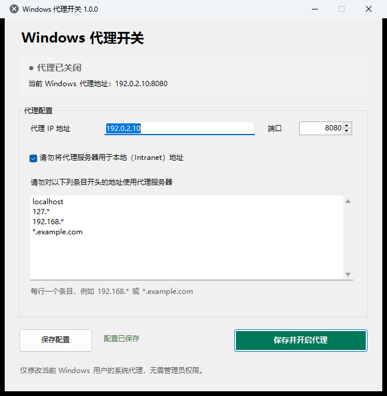

# Windows 代理开关

**一次保存代理配置，以后随时一键开启或关闭。**

当前版本：1.0.0（2026-10-30）

如果你经常需要在“使用代理”和“关闭代理”之间切换，这个小工具可以帮你省去反复打开 Windows 设置、寻找代理页面、重新填写地址和端口的麻烦。

它会记住你的代理 IP、端口和例外地址。需要使用时，点击窗口按钮或右下角托盘图标即可切换；通过本工具关闭代理时，不会清空已经保存的配置。

本工具只负责管理 Windows 系统代理设置，不提供代理服务器或代理节点。使用前，请准备可用的代理 IP 地址和端口。

## 为什么选择它

| 日常使用中的麻烦 | 使用本工具后 |
| --- | --- |
| 每次都要打开 Windows 设置寻找代理选项 | 在软件窗口或右下角托盘中直接切换。 |
| 更换网络环境时反复填写 IP、端口和例外地址 | 配置一次即可保存并重复使用。 |
| 担心关闭代理后，之前填写的内容还要重新设置 | 通过本工具开关代理不会清空已保存的配置。 |
| 不确定代理当前是开启还是关闭 | 绿色对勾表示已开启，灰色叉号表示已关闭，状态一目了然。 |
| 不希望软件一直占用任务栏空间 | 最小化或关闭窗口后，软件会隐藏到托盘继续运行。 |
| 担心退出软件后代理仍然开启 | 从托盘选择“退出”时，会先关闭代理，再退出软件。 |
| 不熟悉命令行，也不想安装复杂环境 | 提供中文图形界面，无需输入命令，无需管理员权限。 |

## 软件界面



截图中的地址仅为文档示例，不是可用的代理节点。

## 开始使用

### 1. 准备代理信息

请向代理服务的提供方确认以下信息：

- 代理 IP 地址。
- 代理端口号。
- 哪些地址需要绕过代理（如果有）。

本软件支持 Windows 11，不需要安装 Python、Node.js 或其他开发工具。

### 2. 打开软件

下载并解压项目后，双击：

```text
Start-ProxySwitch.exe
```

软件会显示主窗口，并在 Windows 右下角托盘中显示图标。如果看不到图标，请点击托盘区域的“显示隐藏的图标”箭头。

重复双击主程序不会打开多个副本。如果软件已经在运行，会重新显示之前打开的窗口；窗口已隐藏到托盘时，也会自动恢复。

### 3. 填写并保存配置

| 配置项 | 填写方法 |
| --- | --- |
| 代理 IP 地址 | 填写代理服务器的 IPv4 或 IPv6 地址，不要添加 `http://`、`https://` 或端口。 |
| 端口 | 填写代理服务使用的端口，范围为 1–65535。 |
| 例外地址 | 每行填写一个不希望使用代理的地址条目。 |
| 本地地址例外 | 勾选后，不将代理用于本地（Intranet）地址。 |

例外地址示例：

```text
localhost
127.*
10.*
192.168.*
*.example.com
```

通常只需在窗口中填写，不必手动编辑配置文件。程序会自动将例外地址转换成 Windows 所需的格式，具体匹配规则由 Windows 决定。

### 4. 一键开启或关闭

- 点击“保存并开启代理”：保存当前配置并立即开启系统代理。
- 点击“保存配置”：只保存修改，暂不改变代理状态。
- 点击“关闭代理”：关闭系统代理，但保留已经保存的配置。

开启成功后，窗口会显示“代理已开启”，托盘图标变为绿色对勾。以后需要切换时，也可以直接左键单击托盘图标。

## 托盘操作：不用打开系统设置

| 你的操作 | 软件会做什么 |
| --- | --- |
| 左键单击托盘图标 | 根据当前状态开启或关闭代理。 |
| 最小化窗口 | 隐藏窗口，软件继续在托盘运行。 |
| 点击窗口右上角“关闭” | 隐藏窗口而不是退出，软件继续在托盘运行。 |
| 再次双击 `Start-ProxySwitch.exe` | 恢复之前已经打开的窗口，不重复启动软件。 |
| 右键托盘图标 →“打开设置” | 重新显示主窗口，可修改配置。 |
| 右键托盘图标 →“退出” | 先关闭 Windows 系统代理，再退出软件。 |

退出时，如果还有未保存的修改，软件会询问是否保存。只有关闭代理成功后才会退出；如果关闭失败，软件会提示原因并继续运行，避免代理仍处于开启状态。

## 配置会一直保留吗？

保存后的配置位于程序目录的 `config.json` 中。正常开启或关闭代理、隐藏窗口、退出后重新打开软件，都不会因为本工具的操作而清空这份配置。

建议不要删除 `config.json`。如果需要重装或备份软件，可以先备份该文件。

同时请注意：

- 组织策略或其他网络管理软件可能改变 Windows 当前的代理状态。
- 部分应用使用自己的代理设置，不一定会读取 Windows 系统代理。
- 某些已经运行的应用需要重启后，才能读取新的代理设置。

## 隐私说明

你的实际配置只保存在本机。`config.json` 可能包含内网 IP、域名等信息，已被 `.gitignore` 排除，不应上传到 GitHub。

项目中的 `config.example.json`、README 截图和示例地址均为脱敏内容，仅用于说明用法。

## 常见问题

### 这款软件本身就是代理服务吗？

不是。它只帮助你保存配置并切换 Windows 系统代理，不能代替代理服务器，也不会提供代理节点。

### 为什么点击窗口关闭按钮后，软件仍在运行？

这是为了方便你随时从托盘切换代理。要真正退出，请右键托盘图标并选择“退出”；软件会先关闭代理，再结束运行。

### 开启代理后，某个应用仍然没有使用代理怎么办？

请先检查该应用是否使用独立的代理设置。如果应用支持读取系统代理，可以尝试重启该应用后再使用。

### 为什么图标显示的状态与我预期不一致？

软件会自动同步 Windows 的实际代理状态。组织策略或其他网络管理软件可能覆盖了你的设置，请检查相关策略或软件。

### 需要管理员权限吗？

不需要。软件只修改当前 Windows 用户的系统代理，不会修改其他用户的设置。

---

版本更新记录请查看 [CHANGELOG](CHANGELOG.md)。
